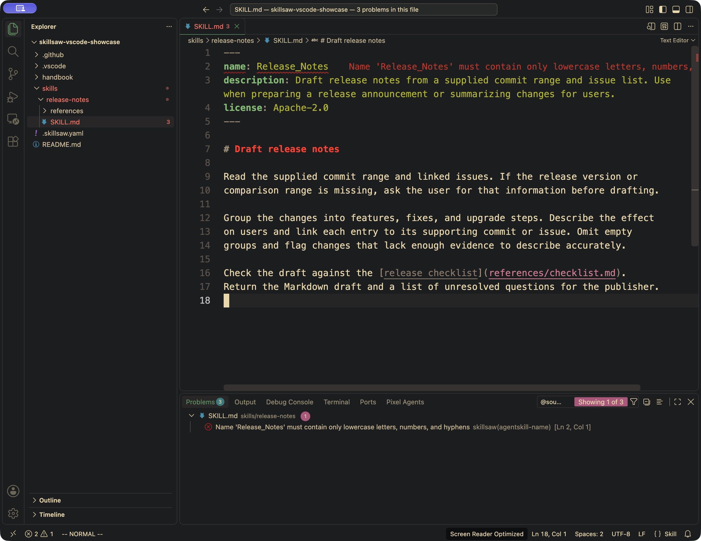
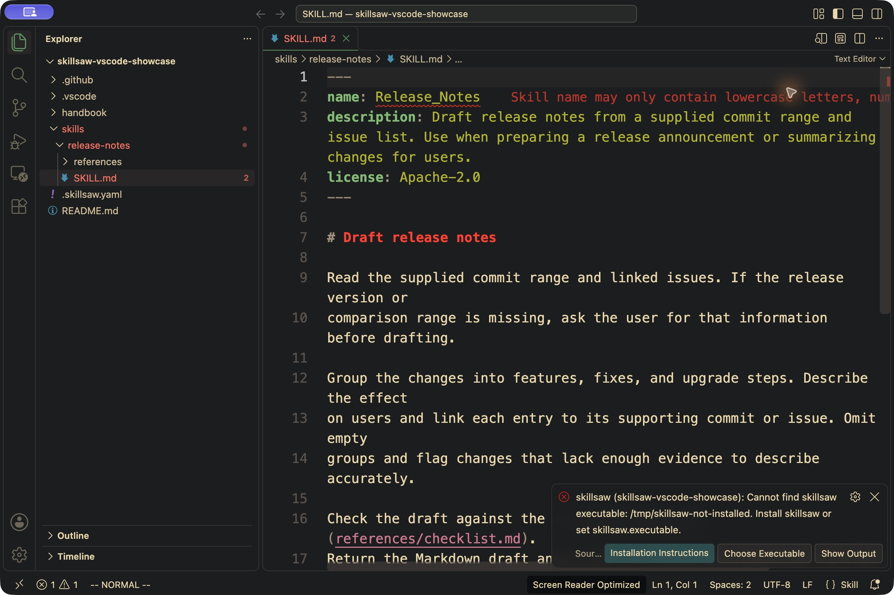

<!-- Generated by scripts/generate-site-content.py — do not edit by hand -->

# skillsaw for VS Code

Lint the files that steer AI coding agents: skills, instructions, hooks, plugins
and tool configuration. See skillsaw findings in the Problems panel and on the
reported source lines, using the same CLI and repository configuration as CI.



The screenshot also uses Error Lens to display the diagnostic text inline.

**The skillsaw CLI must be installed separately.** The extension does not bundle
Python or install software automatically.

## Install

1. Install [skillsaw from the VS Code Marketplace](https://marketplace.visualstudio.com/items?itemName=stbenjam.skillsaw)
   in VS Code 1.96 or newer.
2. Install the CLI, for example with [uv](https://docs.astral.sh/uv/getting-started/installation/):

   ```sh
   uv tool install skillsaw
   ```

   Alternatively, use `pipx install skillsaw`, or install it into your project's
   virtual environment. See the [CLI installation guide](https://skillsaw.org/getting-started/).
3. Open your repository root as a workspace folder and trust it to enable linting.
4. Save a file, or run **skillsaw: Lint Workspaces** from the Command Palette.

The extension looks for `skillsaw` on the extension host's PATH by default.
If it cannot find the CLI, its notification offers **Installation Instructions**
and **Choose Executable**. Select the installed `skillsaw` executable (for
example `.venv/bin/skillsaw`, or `.venv\Scripts\skillsaw.exe` on Windows).
The selection is saved in that workspace folder's settings and linting retries
immediately. Both actions are also available from the Command Palette.



You can instead set **skillsaw: Executable** directly to an absolute path.
**skillsaw: Show Output** lists the executable setting used for each run and the
CLI version returned in its report. A bare executable name is labelled as a
PATH lookup; relative paths are shown resolved from the workspace folder.

For Remote SSH, Dev Containers or WSL, install the extension and CLI on the
remote host. The executable must be available there, not just on your computer.

The CLI can import workspace custom Python rules and installed rule plugins,
just as it does in the terminal. No process runs in Restricted Mode, including
from the explicit lint command. Installing or upgrading the CLI is a separate
user action.

## Use

Open the publisher's repository root as a workspace folder. Save a file, or
run **skillsaw: Lint Workspaces** from the Command Palette. The Problems panel
shows the rule ID, message and severity. **skillsaw: Show Output** shows each
run's CLI version, finding count and exit code, plus CLI stderr and failures.

Each run executes this argument list with the workspace folder as its working
directory:

```sh
skillsaw lint --format json --verbose .
```

Configuration discovery (including parent lookup), version gating, baselines,
exclusions, custom rules, rule plugins, content paths and failure thresholds
remain the CLI's responsibility. `--verbose` includes info findings; it does
not change the failure threshold. Exit 0 and exit 1 with valid JSON both supply
diagnostics. A usage error, missing executable, invalid report, timeout or
oversized output clears that folder's diagnostics and reports the failure.

Every file save inside a workspace folder triggers a whole-folder run. This
also covers new artifacts and arbitrary configured content paths without
maintaining an editor-specific list of supported filenames. VS Code file
creation, rename and deletion operations trigger the same refresh. Each folder
has its own settings and diagnostics in a multi-root workspace; overlapping
folders are linted independently and can produce duplicate findings. Overlapping
folders share an editor refresh scope: events anywhere under their outermost
workspace folder invalidate or refresh each member, so an alias under the parent
can update findings from a nested root. Unrelated roots remain independent.

## Settings

Settings can be set per workspace folder. The executable is a single program
name or path, passed without a shell. Relative paths resolve from that folder;
arguments, `~`, environment variables and `${workspaceFolder}` are not expanded.

| Setting | Default | Behavior |
| --- | --- | --- |
| `skillsaw.executable` | `skillsaw` | CLI on PATH, or its filesystem path |
| `skillsaw.runOnSave` | `true` | Lint on startup, document opens/closes, saves, clean document reloads and editor file operations; `false` leaves the explicit command available |
| `skillsaw.debounceMs` | `600` | Save delay, between 100 and 10,000 ms |
| `skillsaw.timeoutMs` | `30000` | Per-run timeout, between 1,000 and 300,000 ms |

Only one CLI process runs at a time across the window. Each folder has at most
one pending request. Newer saves replace queued work, cancel an older run for
that folder and prevent its results from being published. Output is capped at
8 MiB across stdout and stderr. Use command-only linting or a larger timeout
for a large repository. Command-only results remain visible when you open or
close clean tabs. Opening or closing a document remaps the last report to the
remaining open aliases without running the CLI again. Removing a dirty alias
can lift its suppression of findings when that disk report is still valid.
Edits, file operations and configuration changes invalidate the report; use
the explicit command to produce fresh results.

## Fix workflow

The extension provides diagnostics only. Save your files, then use the CLI in the
workspace root:

```sh
skillsaw fix --dry-run .
skillsaw fix .
git diff
skillsaw lint .
```

`fix` applies the CLI's safe fixes by default. Review the diff; correct remaining
findings with `skillsaw explain RULE-ID`. Run **skillsaw: Lint Workspaces** after
terminal edits. The extension never edits files or runs fixes on save.

Try the complete [publisher walkthrough](https://github.com/stbenjam/skillsaw/tree/main/examples/editor-onboarding):
change one skill name, see the diagnostic, repair it, and validate the same
repository with the existing skillsaw GitHub Action.

## Supported limits

- Diagnostics describe saved files. Editing a buffer cancels the affected folders'
  pending work and clears their diagnostics; dirty documents are omitted from
  subsequent reports until saved. Symlink aliases within a workspace folder or
  overlapping group map to their open documents; a dirty alias suppresses findings
  for that file across the group. Aliases between disjoint workspace roots or
  outside the workspace are not tracked by the extension.
  With `runOnSave` enabled, opening or closing a document schedules a disk refresh.
- The CLI reports a line, not a column range. Findings without a line appear
  at the start of the file. Workspace-wide findings and redacted outside-repo
  paths appear on the workspace folder, labelled as having no available
  location. No outside-repo filename is guessed from the CLI's redaction.
- After terminal fixes or other external edits, run **skillsaw: Lint Workspaces**
  to refresh diagnostics. Dirty-buffer changes clear old diagnostics without
  starting a run. A clean open document reloading from disk also refreshes
  diagnostics when `runOnSave` is enabled, including when another symlink alias
  was saved.
  Saves outside a workspace folder (such as an inherited parent config) also
  need that command. The extension does not maintain a filesystem watcher.
- Virtual workspaces, browser-only VS Code and untitled files are unsupported.
  Install the extension and CLI on the workspace's remote host when using
  Remote SSH, Dev Containers or WSL; linting uses that host's filesystem.
  The automated extension-host smoke test runs locally on Linux; it does not
  exercise those remote connections. Installed-CLI and interpreter cancellation
  tests also run on Windows.
- Cancellation terminates the CLI process, with a forced kill after a short
  grace period. Custom rules are trusted code: processes they detach are not
  managed by the extension.

## Build from source

From the repository root, with Node.js 22+, Python 3.10+ and Make installed:

```sh
make venv
cd editors/vscode
npm ci --ignore-scripts
npm run package
```

Choose **Extensions: Install from VSIX...** and select the generated
`skillsaw-<version>.vsix`. Set **skillsaw: Executable** to this checkout's
`.venv/bin/skillsaw` (or `.venv\Scripts\skillsaw.exe` on Windows).

## Development and verification

From this directory, after `make venv` at the repository root:

```sh
npm ci --ignore-scripts
npm run lint
npm test
xvfb-run -a npm run test:host  # Linux without a display
npm run package
```

`npm test` covers JSON parsing, real CLI/configuration behavior, subprocess
failures, trust gates, debounce, stale results and folder lifecycle. Set
`SKILLSAW_CLI` to an absolute executable path to test another CLI installation.
`test:host` downloads pinned VS Code 1.96.4 and uses disposable multi-root
workspaces with the actual VS Code API and CLI. It checks overlapping roots
with different configurations, parent-root aliases, dirty-buffer invalidation,
removal and re-addition.
It disables workspace trust only in that test instance; the unit tests exercise
the Restricted Mode gates.
With a display, run `npm run test:host` directly.

The implementation follows the VS Code
[diagnostic API](https://code.visualstudio.com/api/references/vscode-api#Diagnostic),
[workspace trust API](https://code.visualstudio.com/api/extension-guides/workspace-trust),
[extension testing guide](https://code.visualstudio.com/api/working-with-extensions/testing-extension)
and [VSIX packaging guide](https://code.visualstudio.com/api/working-with-extensions/publishing-extension#packaging-extensions).

## Releasing the extension

The extension has its own version in `editors/vscode/package.json`, independent
of the Python package. See the [release workflow guide](https://github.com/stbenjam/skillsaw/blob/main/editors/vscode/RELEASING.md)
for Marketplace setup, validation and publishing.
